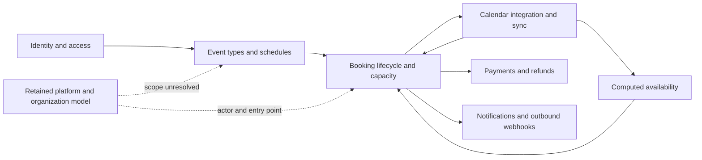

# Cal.diy domain distillation

This is a domain map, not an implementation design. It follows discovery → analysis → classification; aggregate boundaries and priorities are proposals, while quoted behavior is evidence. Repository snapshot: `856cbf7eee15d34cfeb7f9ce8ae314a220bce913`. Paths and line numbers below refer to that working-tree snapshot and are relative to the repository root.

## 0. Discovery and evidence limits

### Product intent and source authority

The product is individual, self-hosted scheduling. The strongest local vision statement is “designed for individuals and self-hosters who want full control over their scheduling infrastructure without any commercial dependencies” (`README.md:43`). The README also recommends “personal, non-production use” (`README.md:2`) and explicitly excludes “Teams, Organizations, Insights, Workflows, SSO/SAML” (`README.md:47`). These statements are the basis for Core/Supporting/Generic classification, not the volume of code inherited from Cal.com.

Discovery searched repository filenames for PRD, vision, requirements, tech-stack, narrative, shape-notes, README and changelog variants, including `context/`, `specs/`, `docs/` and the root. No product-wide PRD, tech-stack document, quantified success criteria or full requirements catalogue was found. There **is** a concrete feature specification: `specs/cancellation-reason-requirement/design.md`. Its design, decisions, implementation log and future-work document were read. Its stated goal is “better tracking and accountability” (`design.md:9`, within that specification directory); its non-goals include reschedule-reason configuration and reason analytics (`specs/cancellation-reason-requirement/design.md:77`). Thus the limitation is incomplete product-wide requirements, not a complete absence of requirements.

Additional sources read or selectively inspected:

- `agents/knowledge-base.md`: managed events, organization/team identity, OAuth terminology, calendar identification, round-robin and workflow distinctions. This contains inherited domain assertions and is not automatically authoritative over the README.
- `packages/features/calendar-subscription/README.md:3`: calendar-cache/sync narrative; `:14` makes an unusually strong reliability promise.
- `specs/cancellation-reason-requirement/implementation.md:3`: says “Status: complete”, but `:27` still lists end-to-end verification as a next step. Completion is a claim, not proof of all entry points obeying the rule.
- `apps/web/CHANGELOG.md`: inspected release entries are dependency updates, not business acceptance criteria. Selected domain entries in `packages/platform/atoms/CHANGELOG.md:163` describe dry-run behavior, and `:221` distinguishes a booking from a recurring series. These are historical source material, not current runtime proof.
- `context/map/repo-map.md` and existing booking research/change briefs: used as navigation aids only. Claims below were checked against source rather than copied from earlier analyses.

The code vocabulary was also inventoried independently: all Prisma `model`/`enum` declarations were enumerated before focusing searches on document terms; booking services, validators, seat handling, refund handling, calendar sync and API callers were then sampled. This revealed concepts absent from the feature specification, including `BookingSeat`, `PaymentOption.HOLD`, `SelectedCalendar`, `Account`, `SeatChangeLog` and `PlatformOAuthClient`.

This is a broad domain inventory with deep verification of booking policy, cancellation, seat capacity, refunds and calendar synchronization. It is not an exhaustive audit of every provider, API version, authentication path or inherited enterprise model. Static branch inspection establishes behavior of the inspected functions, not deployment reachability or incident frequency. Existing tests were read, not executed; no production code, schema or dependencies were changed.

### Stack and layers actually found

| Layer | Evidence and responsibility |
|---|---|
| Workspace/tooling | Yarn `4.12.0` (`package.json:234`), Turbo (`package.json:120`), TypeScript, Biome (`package.json:92`), Vitest (`package.json:122`) and Playwright (`package.json:97`). |
| Web/UI | Next.js `16.2.3`, NextAuth `4.24.13`, React `18.2.0` (`apps/web/package.json:110`, `:111`, `:123`); Tailwind (`apps/web/package.json:195`). Routes live under `apps/web/app/`; view/component code under `apps/web/modules/` and `apps/web/components/`. Cancellation UI invokes domain policy at `apps/web/components/booking/CancelBooking.tsx:167`. |
| API | tRPC under `packages/trpc/server/routers/`; a concrete business caller is `packages/trpc/server/routers/viewer/bookings/reportBooking.handler.ts:85`. API v2 is NestJS (`apps/api/v2/package.json:55`), with versioned controllers under `apps/api/v2/src/platform/`, not the `src/modules/` path suggested by the knowledge base. A cancellation controller calls shared logic at `apps/api/v2/src/platform/bookings/2024-04-15/controllers/bookings.controller.ts:262`. |
| Application/domain behavior | `packages/features/`: booking orchestration in `bookings/lib/service/RegularBookingService.ts:2653`, cancellation in `bookings/lib/handleCancelBooking.ts:135`, policy in `bookings/lib/cancellationReason.ts:3`; availability in `availability/lib/getUserAvailability.ts:228`. There is no single isolated domain layer: rules also live in handlers, helpers and persistence builders. |
| Persistence | PostgreSQL (`packages/prisma/schema.prisma:5`), Prisma (`packages/prisma/package.json:32`), schema/migrations under `packages/prisma/`; repositories such as `packages/features/bookings/repositories/BookingRepository.ts:340`. Some application helpers access Prisma directly, e.g. `packages/features/bookings/lib/handleNewBooking/createBooking.ts:139`. |
| External integration | Provider packages in `packages/app-store/`; calendar adapters and synchronization in `packages/features/calendar-subscription/`; email/calendar identity generation in `packages/emails/lib/getICalUID.ts:14`. These are separate external consistency boundaries. |

## 1. Ubiquitous language

Definitions are distilled from the quoted source, not proposed new entity names. A schema quote proves a persisted concept; it does not alone prove a business workflow is available. “Code-only” marks vocabulary discovered in implementation without a corresponding requirement in the documents inspected.

| ID / term | Meaning in this domain | Source quote and verified code home |
|---|---|---|
| L01 Event type | A reusable bookable offering with duration, owner and booking policy; distinct from a particular appointment. | “model EventType” (`packages/prisma/schema.prisma:156`); `length` at `:168`, `owner` at `:174`, policy fields at `:196` and `:205`. |
| L02 Booking | A particular appointment with identity, time interval, participants and lifecycle state. | “model Booking” (`packages/prisma/schema.prisma:851`); `startTime` at `:869`, `attendees` at `:871`, `status` at `:875`. |
| L03 Booking status | Lifecycle vocabulary: accepted, pending, rejected, cancelled and awaiting host. Payment is a separate dimension. | “AWAITING_HOST” (`packages/prisma/schema.prisma:848`), other states at `:843`; separate `paid` field at `:876`; creation chooses accepted/pending at `packages/features/bookings/lib/handleNewBooking/createBooking.ts:192`. |
| L04 Host / organizer | A person responsible for an event or booking. Event-type membership and the booking's primary host are different representations. | “Who is cancelling (host vs attendee)” (`specs/cancellation-reason-requirement/design.md:35`); `model Host` at `packages/prisma/schema.prisma:61`; cancellation actor classification at `packages/features/bookings/lib/handleCancelBooking.ts:153`. |
| L05 Attendee | A participant attached to a booking, with contact details and timezone; not necessarily an authenticated user. | “model Attendee” (`packages/prisma/schema.prisma:826`); `email` at `:828`, `timeZone` at `:830`, booking relation at `:833`. |
| L06 Cancellation reason requirement | Event-type policy selecting whether host, attendee, both or neither must provide a nonblank cancellation reason. | “MANDATORY_HOST_ONLY” (`specs/cancellation-reason-requirement/design.md:23`); persisted at `packages/prisma/schema.prisma:287`; evaluated at `packages/features/bookings/lib/cancellationReason.ts:7`. |
| L07 Reschedule | Moving an appointment; regular booking persistence creates a replacement linked to the old booking and marks the old one cancelled. Seat-specific paths differ. | “A booking could have been CANCELLED due to a reschedule” (`packages/features/bookings/lib/handleCancelBooking.ts:131`); `fromReschedule` assigned at `packages/features/bookings/lib/handleNewBooking/createBooking.ts:234`, old status changed at `:260`. Code-derived definition. |
| L08 Recurring series | Multiple booking instances grouped by `recurringEventId`; cancellation may affect future instances rather than one booking. | “one individual recurrence of recurring booking” (`packages/platform/atoms/CHANGELOG.md:221`); grouping field at `packages/prisma/schema.prisma:889`; bulk cancellation predicate at `packages/features/bookings/lib/handleCancelBooking.ts:369`. |
| L09 Booking seat | One attendee's reserved place in a capacity-limited appointment, with its own reference and answers. | “model BookingSeat” (`packages/prisma/schema.prisma:1330`); unique attendee at `:1335`; capacity input at `packages/features/bookings/lib/handleSeats/create/createNewSeat.ts:21`. Code-only. |
| L10 Schedule / availability | A named user's schedule holds timezone and available intervals; `Availability` rows describe days/times or date overrides. These are inputs to availability calculation, not reservations. | “model Schedule” (`packages/prisma/schema.prisma:945`), `availability` at `:954`; “model Availability” at `:960`, `days` at `:966`, `date` at `:969`. |
| L11 Slot / busy time | A computed candidate interval or an unavailable interval, derived from working hours and constraints. It is not itself a confirmed booking. | “busy: UserAvailabilityBusyDetails[]” (`packages/features/availability/lib/getUserAvailability.ts:174`), “workingHours: WorkingHoursWithUserId[]” at `:184`; seat-aware busy-time explanation at `:394`. Code-derived. |
| L12 Booking window / notice / limits | Controls for when and how often an event can be booked, including minimum notice, period bounds and frequency/duration limits. | “Limit how many times this event can be booked.” (`packages/i18n/locales/en/common.json:2168`); `minimumBookingNotice` at `packages/prisma/schema.prisma:219`, `bookingLimits` at `:246`, `durationLimits` at `:248`; checked at `packages/features/bookings/lib/service/RegularBookingService.ts:764` and `:817`. |
| L13 Confirmation | Host approval policy affecting whether a new booking starts pending or accepted, potentially dependent on a time threshold. | “Determines if a booking actually requires confirmation” (`packages/features/bookings/lib/doesBookingRequireConfirmation.ts:7`); threshold at `:21`; state selection at `packages/features/bookings/lib/handleNewBooking/createBooking.ts:192`. |
| L14 Managed event type | Parent configuration associated with a team and child event types assigned to users; documents permit booking only children. | “Only child managed event types can be booked.” (`agents/knowledge-base.md:13`); parent/children relation at `packages/prisma/schema.prisma:190`; `MANAGED` at `:45`. Rule enforcement is unresolved below. |
| L15 Team / organization | Organizational grouping represented in one table, with an organization discriminator and parent relationship. Presence does not establish supported Cal.diy product scope. | “Both organizations and teams are stored in the `Team` table” (`agents/knowledge-base.md:17`); `parentId` at `packages/prisma/schema.prisma:587`, `isOrganization` at `:599`. |
| L16 Round-robin / collective | Scheduling modes involving selection among hosts versus joint hosting. The fairness algorithm is retained vocabulary, not established as current product differentiation. | “Weight-based selection”, “Priority ranking”, “Round-robin fairness algorithms” (`agents/knowledge-base.md:72`, `:73`, `:74`); enum at `packages/prisma/schema.prisma:42`; host `priority`/`weight` at `:67`; branches at `packages/features/bookings/lib/service/RegularBookingService.ts:291` and `:298`. |
| L17 Selected calendar | A user's connected calendar selected for availability/subscription processing, including provider identity and sync state. | “SelectedCalendar Extensions” (`packages/features/calendar-subscription/README.md:88`); model at `packages/prisma/schema.prisma:978`; processing entry at `packages/features/calendar-subscription/lib/CalendarSubscriptionService.ts:228`. |
| L18 Destination calendar / calendar event | The external calendar receiving an appointment, and the provider-facing representation of that appointment. | “model DestinationCalendar” (`packages/prisma/schema.prisma:351`), external identifier at `:354`; “export interface CalendarEvent” (`packages/types/Calendar.d.ts:164`); booking destination assignment at `packages/features/bookings/lib/handleNewBooking/createBooking.ts:212`. |
| L19 Calendar cache / sync | Cache stores availability data; sync receives provider changes and translates them into booking operations. | “Stores calendar availability data locally” and “Uses webhooks to automatically listen for calendar updates” (`packages/features/calendar-subscription/README.md:9`, `:10`); dispatch at `packages/features/calendar-subscription/lib/sync/CalendarSyncService.ts:71`. |
| L20 iCalUID | External event identity connecting provider events to local bookings; suffix identifies recognized Cal-managed events. | “iCalUID ends with `@Cal.diy`” (`agents/knowledge-base.md:57`); generation uses configured app name at `packages/emails/lib/getICalUID.ts:30`; accepted suffix set at `packages/features/calendar-subscription/lib/sync/CalendarSyncService.ts:13`. |
| L21 Payment / hold / refund | Provider payment associated with a booking, with independent success/refund state; collecting on booking and holding funds are distinct options. | “ON_BOOKING” / “HOLD” (`packages/prisma/schema.prisma:1116`, `:1117`); payment state at `:1105`; refund selection at `packages/features/bookings/lib/payment/processPaymentRefund.ts:31`. Code-only; do not infer accounting-ledger semantics. |
| L22 Webhook | An outbound subscription delivering selected booking events to a subscriber URL. Provider inbound webhooks have a different role. | “subscriberUrl” and “eventTriggers” (`packages/prisma/schema.prisma:1149`, `:1153`); cancellation delivery at `packages/features/bookings/lib/handleCancelBooking.ts:327`. |
| L23 Workflow | A separate automation feature mentioned in inherited documentation, explicitly excluded by current README scope. | “Workflows and webhooks are two completely separate features” (`agents/knowledge-base.md:90`). **MISSING in code: workflow engine in the searched scope**, not all mentions. The documented constants path is absent; targeted searches for `Workflow`, `WorkflowService`, `WorkflowTrigger`, `workflowSteps`, workflow filenames and automation across `packages/features`, `packages/trpc`, `apps/web`, and Prisma found no engine/model. Residual `automation` app category remains at `packages/prisma/schema.prisma:1256`; it is not an engine. |
| L24 User / account | A scheduling user is distinct from an authentication-provider account linked to that user. | “model User” (`packages/prisma/schema.prisma:401`); “model Account” at `:1217`, provider identity at `:1221`, user relation at `:1232`. Code-derived. |
| L25 OAuth client / platform OAuth client | Third-party account access versus a platform embedding scheduling and managing users. They are explicitly separate client types/tables. | “Allows 3rd party apps to connect users' cal.com accounts” / “Used by platform customers integrating cal.com scheduling directly in their platforms” (`agents/knowledge-base.md:27`, `:28`); `OAuthClient` at `packages/prisma/schema.prisma:1461`, `PlatformOAuthClient` at `:1716`. |
| L26 Billing seat | Subscription quantity change associated with team/organization billing, unrelated to a place in an appointment. | “model SeatChangeLog” (`packages/prisma/schema.prisma:2665`); billing relations at `:2687` and `:2689`. Code-only retained commercial vocabulary. |

### Polysemy and candidate bounded contexts

These are boundary hypotheses supported by different meanings, not instructions to split packages.

| Word | Context A | Context B | Evidence / consequence |
|---|---|---|---|
| Event | **Scheduling catalogue:** `EventType`, reusable policy. | **Calendar integration:** `CalendarEvent`, external appointment representation. | L01/L18. Use “event type”, “booking” and “calendar event” explicitly; a provider update is not an event-type edit. |
| Seat | **Booking participation:** `BookingSeat`. | **Subscription billing:** `SeatChangeLog`. | L09/L26. Capacity and billed headcount must never share an unqualified “seat count” invariant. |
| Host | **Event-type assignment:** any `Host` member/owner. | **Booking lifecycle:** the booking's primary user or matching `cancelledBy` email. | `handleCancelBooking.ts:153` classifies reason policy differently from whole-seat cancellation authorization at `:177`. A co-host may pass authorization without being classified as host for reason policy; this is a decision question, not a proven exploit. |
| Account / client | **Identity/access:** provider `Account` and `OAuthClient`. | **Embedded scheduling platform:** `PlatformOAuthClient` and managed users. | L24/L25. A provider account is not the customer, and platform client permission is not automatically an exemption from booking policy. |
| Availability | **Schedule configuration:** stored working intervals. | **Booking allocation:** computed free/busy result after external calendars and booking limits. | L10/L11. A schedule can permit an interval that is currently busy. |
| Webhook | **Outbound integration:** subscriber receives booking lifecycle notifications. | **Calendar synchronization:** provider sends changes into Cal.diy. | L19/L22. Inbound cancellation can suppress outbound calendar deletion to prevent feedback loops (`handleCancelBooking.ts:444`). |
| Cancelled | **Booking lifecycle:** appointment cancelled, including an old rescheduled record. | **Calendar synchronization:** provider deletion/cancellation translated into a command. | L03/L07 and `CalendarSyncService.ts:73`. Local cancellation does not imply refund completion or external deletion completion. |

### Context relationships

The bidirectional calendar relationship crosses an external consistency boundary. A database transaction cannot make a provider cancellation and local booking cancellation indivisible. Workflows are intentionally absent from this active-context hypothesis because no engine was found and the README excludes them.

## 2. Subdomain classification

Each language entry is assigned once below. Classification is a product interpretation grounded in the local README, not a claim that every retained area is supported.

| Concepts / area | Category | Justification tied to product intent |
|---|---|---|
| L01–L13: event types, booking lifecycle, actors, cancellation, recurrence, capacity, schedules, availability, limits and confirmation | **Core** | These give “scheduling platform” its meaning (`README.md:16`) and let individuals control scheduling (`README.md:43`). Cancellation accountability is explicitly requested (`specs/cancellation-reason-requirement/design.md:9`). No evidence establishes a narrower competitive differentiator or quantified priority. |
| L14–L16: managed events, teams/organizations, round-robin/collective | **Supporting, retained/out of stated scope** | They organize multi-user scheduling but are not justified as Cal.diy's core advantage; enterprise teams/organizations are excluded (`README.md:47`). Classification is provisional until retained compatibility versus supported feature scope is decided. |
| L17–L20: calendar selection, destinations, cache/sync and iCal identity | **Supporting** | Necessary to coordinate self-hosted scheduling with external calendars; local feature narrative emphasizes fewer API calls and consistency (`packages/features/calendar-subscription/README.md:18`). Provider protocols do not define the product's differentiator. |
| L21: payments, holds, refunds | **Generic** | Payment processing is a reusable external capability. Booking-specific refund eligibility is a policy integration, but the local vision contains no financial-product advantage (`README.md:43`). |
| L22: outbound webhooks | **Supporting** | Communicates scheduling outcomes to integrations. The scheduling events are domain-specific even though HTTP delivery is generic; control over one's infrastructure is the relevant goal (`README.md:43`). |
| L23: workflows | **Supporting, excluded** | Automation would support scheduling; the README explicitly removes it (`README.md:47`). It is not an active core capability merely because the knowledge base mentions it. |
| L24: users/authentication accounts | **Generic** | Identity and authentication enable user control but are not the scheduling advantage (`README.md:43`); provider-account uniqueness is standard access infrastructure. |
| L25: OAuth clients/platform access | **Generic, platform scope unresolved** | Delegated authorization and embedded-client identity are reusable infrastructure; platform customer scope conflicts with the individual/self-hosting focus (`README.md:43`, `agents/knowledge-base.md:28`). |
| L26: billing seats | **Generic, retained/out of stated scope** | Subscription billing supports a commercial organization model, explicitly outside the stated enterprise-free product boundary (`README.md:47`). Schema presence alone is not an endorsed capability. |

## 3. Aggregate candidates and invariants

An aggregate is proposed around a consistency rule, not around every database table. `BookingSeat` is a child of the **Booking capacity boundary**, not an independent aggregate that can safely enforce total capacity alone. Calendar/provider effects and refunds need cross-boundary coordination; they are not part of one giant booking database transaction.

Status terms: **enforces** = inspected code checks or constrains the rule; **declares** = represented but enforcement not established; **ignores** = a relevant path bypasses evaluation; **contradicts** = inspected behavior opposes the quoted rule. These statuses are scoped to the cited paths, not universal guarantees.

| Candidate / ownership hypothesis | Rule that must hold, with source quote | Observed status and evidence |
|---|---|---|
| **A1 Booking**, owning participants, seats and lifecycle transitions | Required cancellation reasons apply to the configured actor, including “Platform users: Should respect the setting” (`specs/cancellation-reason-requirement/design.md:70`). Null/no-event settings use host-only default (`:72`, `:73`). | **Enforces** default/actor mapping in `packages/features/bookings/lib/cancellationReason.ts:7`; **contradicts** universal platform application in `packages/features/bookings/lib/handleCancelBooking.ts:161`, which skips it for nonempty `platformClientId`. Reporting explicitly bypasses evaluation at `packages/trpc/server/routers/viewer/bookings/reportBooking.handler.ts:89`. |
| **A1 Booking**, same root, capacity rule | “concurrent requests could exceed the seat limit” must be prevented (`packages/features/bookings/lib/handleSeats/create/createNewSeat.ts:39`). | **Enforces for adding to an existing booking:** row lock at `:47`, fresh count at `:70`, guard at `:71`, attendee/seat creation in the same transaction at `:79`. A concurrent last-seat integration test exists at `packages/features/bookings/lib/handleSeats/create/createNewSeat.integration-test.ts:64`. First-seat creation and all reschedule merge paths were not proven equivalent. |
| **A1 Booking**, same root, reschedule/cancellation rule | “We prevent cancelling an already cancelled booking” to avoid deleting a rescheduled meeting (`packages/features/bookings/lib/handleCancelBooking.ts:130`). | **Enforces sequentially** at `:135`. Regular replacement creation and cancellation of the old record are transactional (`packages/features/bookings/lib/handleNewBooking/createBooking.ts:139`). The initial cancellation guard and later update are separated; concurrent duplicate cancellation exclusion is **not established** by this check. |
| **A2 EventType**, owning booking policies and referencing schedules/hosts | Bookings must satisfy configured duration and time policy: “Invalid event length” (`packages/features/bookings/lib/handleNewBooking/validateEventLength.ts:27`), “Minimum notice” (`packages/i18n/locales/en/common.json:1305`). | **Enforces** allowed duration at `validateEventLength.ts:24`. Time policy is evaluated at `packages/features/bookings/lib/handleNewBooking/validateBookingTimeIsNotOutOfBounds.ts:33`, but **ignored after unexpected evaluator failure** at `:46`: it logs “Defaulting to false” (`:48`) and only rethrows a past-date error. This proves unverified acceptance, not that every such request is actually out of bounds. |
| **A2 EventType**, managed-parent rule | “Only child managed event types can be booked.” (`agents/knowledge-base.md:13`). | **Declares; enforcement unknown.** Parent/child relation exists (`packages/prisma/schema.prisma:190`). Targeted searches for `MANAGED`, managed/parent booking, `schedulingType` and `parentId` in booking services, `handleNewBooking`, `apps/web/lib` and `packages/lib` did not establish a direct booking guard. A UI configuration branch (`packages/features/eventtypes/lib/getEventTypeById.ts:206`) is not a booking prohibition. This is not proof that a parent is bookable. |
| **A3 SelectedCalendar subscription**, owning provider cursor/cache progress | Local narrative says “Guarantees updates through webhook event delivery” (`packages/features/calendar-subscription/README.md:14`). The proposed safety condition is that successful sync acknowledgement must not lose unapplied booking changes. | **Contradicts the unconditional guarantee on the inspected failure path:** cursor and `syncedAt` advance at `packages/features/calendar-subscription/lib/CalendarSubscriptionService.ts:319`, before sync at `:337`; cancellation errors are caught/logged without rethrow at `packages/features/calendar-subscription/lib/sync/CalendarSyncService.ts:146`. `eventsSynced` then counts fetched items at `CalendarSubscriptionService.ts:338`. Eventual convergence is a cross-context obligation, not a synchronous aggregate invariant. A durable replay mechanism was not established. |
| **A4 Payment**, owning payment/refund state and referring to booking identity | For eligible paid seats, “refund every successful (not-yet-refunded) payment” (`packages/features/bookings/lib/payment/processPaymentRefund.ts:29`). Eligibility still depends on refund policy and deadline. | **Enforces local selection/attempts:** filter at `:31`, policy gate at `:42`, deadline at `:76`, independent attempts at `:89`. **Does not guarantee eventual completion:** missing credentials return at `:71`; aggregate errors are caught/logged by cancellation at `packages/features/bookings/lib/handleCancelBooking.ts:414`. Provider idempotency and durable retry were not assessed. |
| **A5 Identity account**, owning the provider identity link | An authentication provider identity must not be linked twice: “@@unique([provider, providerAccountId])” (`packages/prisma/schema.prisma:1234`). This is a code-derived invariant, not a discovered product requirement. | **Enforces in declared database schema.** `Account` links back to a user at `:1232`. Migration deployment and provider login flows were not tested. Low evidence of a refactor need. |

`Schedule` is currently a configuration/entity candidate, not a ranked aggregate: the inspected sources establish its data shape but do not justify an independent transaction boundary or a new “intervals must never overlap” rule. Likewise, `User`, `Team`, `OAuthClient` and `Webhook` model names alone are insufficient to claim aggregate ownership rules. A recurring series is a grouping/process candidate until its all-or-some cancellation semantics are clarified.

## 4. MODEL versus CODE discrepancies

“Fix: decision” means an owner must resolve semantics before choosing code or documentation. No document is marked obsolete solely because code differs. No later recorded decision was found in the inspected specification decision log authorizing the platform/reporting exemptions or weakened synchronization guarantee.

| ID | Document/model says | Code does | Verified proof | What to fix |
|---|---|---|---|---|
| D1 | Platform users respect the cancellation setting (`specs/cancellation-reason-requirement/design.md:70`). | A nonempty platform client ID bypasses mandatory-reason validation. A versioned API controller actually supplies that ID. | `packages/features/bookings/lib/handleCancelBooking.ts:161`; `apps/api/v2/src/platform/bookings/2024-04-15/controllers/bookings.controller.ts:267`. | **Decision**, then code if the specification remains binding. Resolve whether retained platform endpoints are supported and whether the exemption is intentional. This is a definite branch-level contradiction, not proof of a deployed exploit. |
| D2 | Reason obligation depends on setting and host/attendee (`specs/cancellation-reason-requirement/design.md:33`); no abuse-report exception is specified. | Reporting an upcoming booking requests cancellation with `skipCancellationReasonValidation: true` and supplies no cancellation reason in that call. | `packages/trpc/server/routers/viewer/bookings/reportBooking.handler.ts:69`, `:85`, `:89`; bypass honored at `packages/features/bookings/lib/handleCancelBooking.ts:161`. | **Decision.** A safety/reporting exception may be valid; define whether the report itself satisfies accountability or this is a deliberate exemption. Do not remove it merely to match a dropdown. |
| D3 | Calendar sync “Guarantees updates” (`packages/features/calendar-subscription/README.md:14`). | Progress advances before applying booking changes; a failed booking cancellation is logged and resolved, and fetched events are counted as synced. | `packages/features/calendar-subscription/lib/CalendarSubscriptionService.ts:319`, `:337`, `:338`; `packages/features/calendar-subscription/lib/sync/CalendarSyncService.ts:146`. | **Decision**, then code if guaranteed convergence is required. Confirm retry/replay ownership. The inspected path cannot substantiate the guarantee; an external repair process remains unknown. |
| D4 | Minimum-notice and booking-window controls represent booking restrictions (`packages/i18n/locales/en/common.json:1305`; `packages/prisma/schema.prisma:196`, `:219`). | Unexpected bounds-evaluation errors leave `timeOutOfBounds = false`; only the recognized past-date error is rethrown. | `packages/features/bookings/lib/handleNewBooking/validateBookingTimeIsNotOutOfBounds.ts:31`, `:46`, `:51`, `:57`. | **Decision.** Explicitly choose rejection versus availability under evaluator failure. This is a policy-evaluation gap, not a demonstrated out-of-window persisted booking. |
| D5 | Frequency limit UI promises to “Limit how many times this event can be booked” (`packages/i18n/locales/en/common.json:2168`). | Calendar-imported rescheduling requests skip availability and event-limit checks; the regular service honors the event-limit skip. | `packages/features/calendar-subscription/lib/sync/CalendarSyncService.ts:218`, `:219`; `packages/features/bookings/lib/service/RegularBookingService.ts:816`. | **Decision.** Is a provider-side edit authoritative, or must it obey the same limits as a public booking? This may be an intentional context distinction, not a defect. |
| D6 | README says enterprise teams/organizations/workflows are removed (`README.md:47`); the knowledge base still describes them as product features (`agents/knowledge-base.md:17`, `:90`). | Team/organization and platform/billing schemas remain, as do managed-event branches; the documented workflow engine path is absent. | `packages/prisma/schema.prisma:557`, `:1716`, `:2665`; `packages/features/eventtypes/lib/getEventTypeById.ts:206`; targeted workflow search recorded in L23. | **Decision.** Define supported features versus compatibility data and dead inherited vocabulary. Do not infer all enterprise features are reachable, or delete schemas based on README wording. |
| D7 | Cancellation code's own rationale says “by cancelling first” integrations may fail without preventing cancellation (`packages/features/bookings/lib/handleCancelBooking.ts:357`). This is implementation-declared intent, not a product requirement. | Outbound cancellation webhooks are sent and awaited before the database status update. A recipient can observe a cancellation before local persistence succeeds. | Webhook call at `packages/features/bookings/lib/handleCancelBooking.ts:328`, wait at `:342`, updates at `:367` / `:394`. | **Decision.** Decide whether the webhook means cancellation requested or durably cancelled. If the latter, code must satisfy that ordering contract. No failure was injected in this analysis. |

Two apparent discrepancies were deliberately **not** reported as defects. First, the knowledge base's default `@Cal.diy` iCalUID description is not an exclusive-suffix rule: generation preserves an existing identity (`packages/emails/lib/getICalUID.ts:26`), and sync deliberately accepts legacy/configured suffixes (`packages/features/calendar-subscription/lib/sync/CalendarSyncService.ts:14`). Local commit `0968bcef01` (2026-07-07, “fix(calendar): sync Cal.diy iCalUID events”) provides historical context. Second, “Status: complete” in the cancellation implementation log does not claim the pending E2E checks passed; that verification remains explicitly pending there.

## 5. Refactor ranking

Value means importance of the invariant to the stated scheduling product. Risk means observed weakness in enforcement, not code size or commit frequency. Ratings are qualitative; runtime impact and production usage are unknown. Each condition below is an observable acceptance check, not an implementation design. Proposed checks were not run during this documentation task.

| Rank / aggregate | Value / enforcement risk | Why this order | Done when… |
|---|---|---|---|
| **1 — A1 Booking** | **High / High** | Core lifecycle policy is inconsistent across actors and entry points (D1/D2), and cancellation notification can precede persistence (D7). Existing seat locks should be preserved, not replaced indiscriminately. | A contract test matrix covering all four cancellation settings × host/attendee × web/platform/report entry points passes against an owner-approved exception table, asserting both the outcome and absence of persistence/notification effects for rejected cancellations. |
| **2 — A2 EventType policy** | **High / Medium–High** | Host control depends on policy evaluation actually succeeding; unexpected time-check failures permit continuation (D4). Managed-parent prohibition is documented but not proven at the booking boundary. | An injected unexpected booking-window evaluator error produces the explicitly approved outcome, and a managed-parent booking test rejects while an otherwise valid assigned-child booking succeeds if managed events remain supported. |
| **3 — A3 SelectedCalendar subscription** | **High supporting value / High** | Provider updates feed the core booking model; cursor advancement and swallowed application errors threaten the documented convergence promise (D3). | A failure-injection test fails the first local cancellation application, reprocesses/retries the provider change, and observes the booking eventually cancelled without the failed attempt being reported as successfully applied. |
| **4 — A4 Payment** | **Medium / Medium** | Monetary consequences matter, but the current loop already attempts every eligible seat refund. The open risk is completion/recovery across the provider boundary, not “only the first seat is refunded.” | With two eligible payments and one transient provider failure, a recovery test finishes with both refunded and exactly one successful provider refund per payment; existing policy/deadline exclusions remain unchanged. |
| **5 — A5 Identity account** | **Medium enabling value / Low observed risk** | Provider uniqueness is explicit and constrained; no evidence here justifies restructuring identity ahead of booking policy. | A database-backed test attempting a second account with the same provider/provider-account ID fails and leaves exactly one identity link. |

**First refactor target: the Booking lifecycle boundary**, beginning with the cancellation actor/entry-point contract. The clearest explicit requirement/code conflict is D1. This recommendation is conditional on the owner resolving platform support and reporting exceptions; it does not authorize silently eliminating legitimate exceptions. Capacity should remain within this boundary: the existing last-seat concurrency test is a valuable preservation check, not evidence that all capacity mutation paths have been audited.

### Short questions for people who can decide

| Question | Role best placed to answer |
|---|---|
| Are retained platform API booking endpoints supported in this Cal.diy distribution, or compatibility leftovers? | Cal.diy product maintainer / release owner |
| Should platform cancellation obey the four reason settings without exemption? | Booking product owner + API owner |
| Does an abuse report substitute for a cancellation reason, or explicitly waive it? | Trust/safety owner + booking product owner |
| Does “host” for cancellation reasons include every co-host and the event-type owner, or only the booking's primary organizer? | Booking product owner |
| Must a booking-window evaluation error reject the booking, or is fail-open behavior deliberate? | Scheduling product owner |
| Do provider-side reschedules override booking limits and availability? | Calendar-integration product owner |
| What durable mechanism retries a failed booking update after a calendar sync cursor advances? | Calendar integration maintainer / operations owner |
| Does a cancellation webhook mean a request or a committed transition? | Integration API owner |
| Which service owns retries for failed eligible refunds? | Payments integration maintainer |
| Are managed event types still supported, and where is the parent-booking prohibition tested? | Event-type maintainer |

These questions can be answered without a redesign. Until then, they remain explicit unknowns rather than invented requirements or declarations that one side is obsolete.
