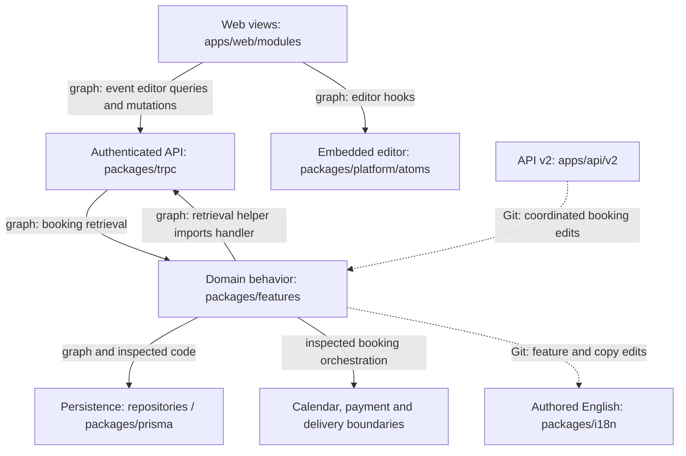

# Cal.diy repository map

## 1. TL;DR

Cal.diy is a scheduling product whose central journey is configuring an event, booking it, and managing its calendar, payment and notification consequences.
The web application lives in `apps/web`, shared behavior in `packages/features`, authenticated operations in `packages/trpc`, API v2 in `apps/api/v2`, and persistence in `packages/prisma`.
Bookings dominate the year's activity; event settings, workflows and the shared schema matter more to behavioral changes than their directory sizes suggest.
English translations are another frequent editing destination, primarily because product changes need shared copy.
The main change hazards are booking side effects, a booking-retrieval runtime cycle, email verification's watchlist cycle, and event saves crossing client/server cache boundaries.
Start with the eight files below and consult contributors by specialty; this is a one-year activity map with a static structural snapshot, not a complete architecture or reliability verdict.

Arrows describe the labeled evidence, not a universal request flow. The reverse tRPC edge is specific to retrieval. Dashed Git relationships show co-change, not imports. Provider internals, database execution and the workflow implementation have no dependency graph in these artifacts.

## 2. Territory

**The product core is spread across layers.** Booking behavior is in `packages/features/bookings`, its views in `apps/web/modules/bookings`, its authenticated handlers in `packages/trpc/server/routers/viewer/bookings`, and its platform API in `apps/api/v2/src/platform/bookings`. The territory artifact's `features/bookings` label groups feature and web-module paths; it is not a literal directory. Event settings similarly span `packages/features/eventtypes`, `apps/web/modules/event-types` and the embedded editor under `packages/platform/atoms/event-types`.

**Responsibility matters more than apparent size.** Creation and cancellation are deep orchestration modules: they coordinate persistence, availability, credentials, calendars, payments and messages. `BookingRepository` has a much narrower retained import surface and an injected client despite frequent edits. Conversely, onboarding's small store/hook graph hides IndexedDB, local-storage fallback, redirects and welcome state. Profile settings and booking details also cross session/cache/browser-state boundaries; shallow import counts do not imply simple behavior. [Structure](artifact-2-structure.md)

**Shared foundations are active, not peripheral.** Prisma defines persisted contracts; English i18n is a common authored input. Auth, settings, teams, shell and onboarding support the central journey. The sources do not establish a repository-wide list of low-criticality peripheral modules. The historical companion app is outside this checkout: it moved to `calcom/companion`, so its formerly strong co-change relationships do not describe the current system. [Territory](artifact-1-territory.md)

**Over the year**, bookings led with 254 commits, followed by translations; event settings and persistence were the next major concentrations. The history records service decomposition, audit propagation and repeated edge-case corrections, including seats, rescheduling and delivery. There is no monthly series in the artifacts: do not infer acceleration, decline or current team workload from these totals.

## 3. Actual connections

- **Booking services and APIs — Git plus import graph.** Surviving-file history has 22 shared booking/tRPC commits, representing 52.4% of the smaller area's sample; API v2 shares 18 booking commits. The graph independently confirms `getAllUserBookings.ts → get.handler.ts → getAllUserBookings.ts`, both value imports. This ties shared retrieval to its consuming API layer; it does not prove infinite recursion. API v2 has no dedicated app-configured graph here, so its complete import topology remains unknown.
- **Booking changes and persistence — Git plus inspected code.** Bookings and Prisma share 21 surviving-file commits, and creation/cancellation orchestrate stored state and external effects. Schema changes are manually authored modeling/migration work. Prisma-derived types are regeneration work; neither TypeScript imports nor mocked raw-query results establish SQL, constraints or database-runtime dependencies. There is no database dependency graph.
- **Event settings and embedded editing — Git plus graph/code inspection.** Web/domain event settings co-change with embedded atoms (8 shared commits in a small 11-commit denominator). The web wrapper actually consumes atoms hooks and tRPC and invokes server revalidation. A successful mocked mutation cannot prove the public booking page sees the new setting.
- **Verification and watchlist administration — import graph.** Under `packages/features`, the runtime chain is `auth/lib/verifyEmail.ts → watchlist/operations/check-if-email-in-watchlist.controller.ts → di/watchlist/containers/watchlist.ts → watchlist/lib/service/AdminWatchlistOperationsService.ts → verifyEmail.ts`. Blocking checks therefore load administrative composition that calls verification back.
- **Booking, payment and notification contracts — inspected code and Git.** Paid-booking trigger correction #26044 and webhook compatibility rollback #27891 show contracts crossing confirmation/payment/delivery boundaries. These require deliberate code and payload review. Workflow delivery has recurring historical fixes, but its implementation was absent from the graph; connectivity is unknown, not absent. Do not use the gap itself as a second independent failure signal.

Sources: [territory and co-change method](artifact-1-territory.md), [graph and test boundaries](artifact-2-structure.md), [commit reading notes](artifact-3-contributors.md).

### Looks risky, but isn't

These are false alarms for the particular inference, not blanket declarations of safety:

- **Large cycle warnings:** service/DTO and repository loops are type-only; cancellation/calendar and several editor/settings loops disappear when type edges are removed. They may require coordinated type edits, but are not runtime cycles. `dist`, `build`, `.next` and configured generated outputs were excluded, so no build-output cycle is being promoted to a source risk.
- **Shared-file churn:** English `common.json` and `schema.prisma` are authored inputs. Generated locale updates, `docs/api-reference/v2/openapi.json`, Prisma outputs and `yarn.lock` involve regeneration or tool maintenance, usually less manual implementation work than editing their consumers. Output review still matters. The artifacts identify generation mechanisms but do not establish that CI enforces every regeneration step.
- **Configuration as code:** `turbo.json` is build configuration, not a product-runtime hub or an identified generated file. Its co-change breadth cannot alone establish business coupling.
- **Mock and CI churn:** missing `vi.mock` fixes and worker-shutdown flakes are test-harness work, not independent booking failures. Auth's many mocks indicate isolation overhead, not 36 runtime defects. Mocked `$queryRaw` responses and mocked revalidation success also provide no proof of real database/cache correctness. No general trial-and-error CI pattern was established.
- **Duplicate signals from one cause:** a booking fix that also changes schema, copy and tests is one feature correction, not four incidents. Likewise, broad typography/branding rollbacks and onboarding rollout changes should be attributed once to their actual concern. Translation corrections and event-editor polish do not justify treating their whole fix rate as behavioral instability.

## 4. Risk zones

These are change-risk priorities, each supported by history and structural evidence; they are not measured incident severity. All paths in this section and First day were verified to exist on 2026-10-20 before saving.

| Product zone | Where it lives | Why to take care: independent signals |
|---|---|---|
| **Creating, rescheduling and refunding bookings** | `packages/features/bookings/lib/service/RegularBookingService.ts`; `packages/features/bookings/lib/handleCancelBooking.ts`; `packages/features/bookings/lib/payment/processPaymentRefund.ts` | **Git:** repeated seat/refund/meeting-URL corrections; **structure/code:** persistence plus multiple external side effects with only partial injection. |
| **Listing and managing accessible bookings** | `packages/features/bookings/lib/getAllUserBookings.ts`; `packages/trpc/server/routers/viewer/bookings/get.handler.ts` | **Git:** substantial booking/router co-change; **graph:** a real helper/handler runtime cycle crosses the shared-logic/API boundary. |
| **Saving settings that govern public booking** | `apps/web/modules/event-types/components/EventTypeWebWrapper.tsx`; `packages/features/eventtypes/repositories/eventTypeRepository.ts`; `packages/platform/atoms/event-types` | **Git:** functional persistence/date/host fixes; **graph/code:** shared editor hooks and client-cache/server-revalidation coordination. |
| **Login and email verification** | `packages/features/auth/lib/verifyEmail.ts`; `packages/features/auth/lib/next-auth-options.ts`; `packages/features/watchlist/lib/service/AdminWatchlistOperationsService.ts` | **Git:** active auth area (67 commits); **graph/code:** verification/watchlist runtime cycle and session callbacks spanning database, identity and rate-limit boundaries. |

Keep workflow delivery on the investigation list, but do not invent structural confirmation. Prisma activity alone does not establish a separate database-failure zone. Booking test removals warrant checking coverage rationale; they do not prove no replacement coverage exists.

## 5. Whom to ask

These are experience-based contacts from [the contributor artifact](artifact-3-contributors.md), not verified current owners.

| Zone | Candidates and useful context |
|---|---|
| Booking creation/rescheduling/refunds | **Hariom Balhara** for service/audit boundaries (#24159, #26046); **Anik Dhabal Babu** for calendar and paid-notification edge cases (#26914, #26044). For the specific all-seat refund invariant, read shafi-VM's #29685 (`761b780aa2`). |
| Accessible booking management | **Rajiv Sahal** for attendee APIs and administrator permissions (#24640, #27781); **Benny Joo** for repository/layer boundaries. Neither is established as the retrieval cycle's author. |
| Public event-setting behavior | **Udit Takkar** for cancellation settings and host locations (#26872, #25916); **Morgan** for platform host-filter propagation (#25627, #26122). These are adjacent specialties, not proven ownership of both editors. |
| Login/verification | **Benny Joo** is a starting referral for verification-layer extraction (#25639); **Dhairyashil Shinde** for reschedule/blocking exceptions (#26002, #25427). The artifacts do not identify an auth/watchlist owner; both candidates are inferred from adjacent booking work. |

For webhook changes, read Syed Ali Shahbaz's #27891 (`3a7122d613`): an internal assignment-reason format was kept for email/UI but removed from public webhook payloads. Ask Romit about integration-suite removals #29019–#29021 before assuming historical coverage remains. Participation is broad but specialized: the top seven authors account for 65.5% of the narrower booking sample; no single author dominates the whole lifecycle.

## 6. First day

Read in order, using the questions to keep the first pass focused rather than reading each large file end to end:

1. [packages/prisma/schema.prisma](../../packages/prisma/schema.prisma) — locate bookings, attendees/seats, payments and event settings; establish the persisted vocabulary.
2. [packages/features/bookings/lib/service/RegularBookingService.ts](../../packages/features/bookings/lib/service/RegularBookingService.ts) — trace validation to creation/rescheduling and then external effects; mark injection versus direct construction.
3. [packages/features/bookings/repositories/BookingRepository.ts](../../packages/features/bookings/repositories/BookingRepository.ts) — see the persistence seam and where a real database is needed to verify query behavior.
4. [packages/features/bookings/lib/handleCancelBooking.ts](../../packages/features/bookings/lib/handleCancelBooking.ts) — follow whole-booking versus seat cancellation, refund intent and calendar/message cleanup; use #29685 as the edge-case companion.
5. [packages/features/bookings/lib/getAllUserBookings.ts](../../packages/features/bookings/lib/getAllUserBookings.ts) — locate the import back into tRPC; understand authorization, filters and pagination before moving logic.
6. [apps/web/modules/event-types/components/EventTypeWebWrapper.tsx](../../apps/web/modules/event-types/components/EventTypeWebWrapper.tsx) — follow save through mutation and revalidation; ask when the public booking page observes it.
7. [packages/features/auth/lib/verifyEmail.ts](../../packages/features/auth/lib/verifyEmail.ts) — follow the watchlist composition boundary and distinguish blocking from administrative unlock behavior.
8. [apps/web/modules/onboarding/store/onboarding-store.ts](../../apps/web/modules/onboarding/store/onboarding-store.ts) — learn why browser persistence, reloads and storage reset matter even in a small module.

## 7. Limitations

- **Window and snapshots:** activity covers 2025-10-20 through 2026-10-20 using Git committer dates. Territory, structure and contributors reference different HEADs (`7f5c3d2`, `16d9014`, `a42c0a4`). This synthesis refreshes path existence only; it does not rerun history, graph analysis or tests.
- **Method:** territory filters automation, mechanical and file noise, consolidates detected renames, and excludes commits touching more than ten areas for co-change. Pair percentages use the smaller area's commit count, not a probability of breakage. Contributor analysis is narrower, excludes agent-primary commits and does not count reviews; territory retains identifiable AI authors. Their denominators are not interchangeable.
- **Graph coverage:** dependency-cruiser scanned web/packages with one web tsconfig, leaving 77 unresolved imports in the cross-check. External package internals, generated/build outputs and workflow implementation were not assessed. There is no dedicated API v2, SQL/database, provider-runtime or external companion graph. Other languages or stack layers are not established as covered; missing edges are unknown.
- **Interpretation:** static imports do not prove execution, cycles do not prove incidents, and fix subjects include polish/maintenance. Commit frequency does not establish expertise, availability, formal ownership or a bus factor. Multiple manifestations of one change were not counted as independent risk evidence.
- **Unavailable evidence:** authenticated GitHub discussion/review data, rejected alternatives, production incident severity and comprehensive test coverage. Local commit bodies can contain intermediate or unrelated history; inspect final patches for decisions. No contributors were contacted.

Source detail: [1 — Territory](artifact-1-territory.md), [2 — Structure](artifact-2-structure.md), [3 — Contributors](artifact-3-contributors.md).
